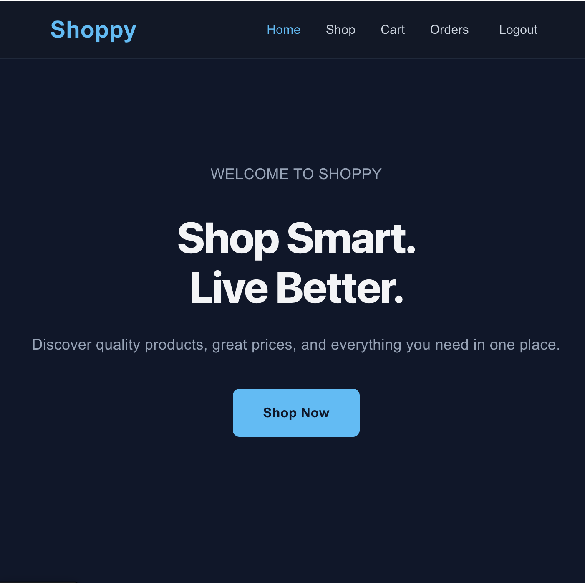
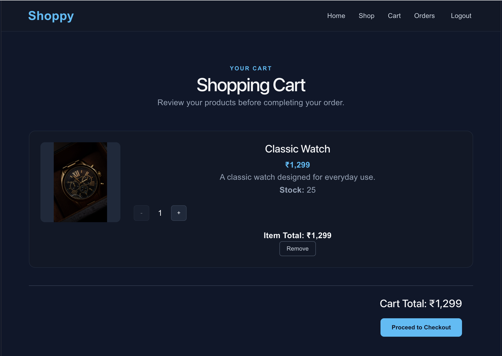
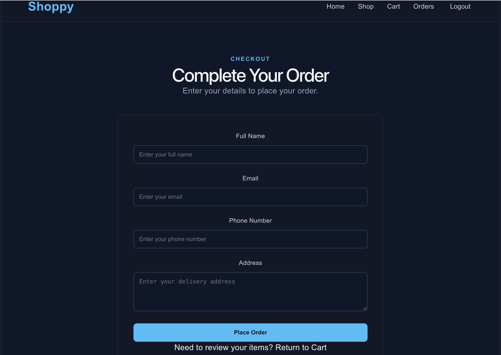

# Shoppy – MERN E-Commerce Website

Shoppy is a full-stack e-commerce web application built using the MERN stack. It provides a simple shopping experience where users can browse products, manage their cart, place orders, and track their purchases.

## Features

### Customer Features
- Browse available products
- View individual product details
- Add products to the shopping cart
- Proceed through checkout and place orders
- Register and log in to an account
- View previous orders

### Admin Features
- View dashboard statistics
- Add, update, and delete products
- View customer orders
- Update order statuses

## Technologies Used

**Frontend**
- React
- JavaScript
- Vite
- CSS
## Screenshots

### 1. Home Page


### 2. Shop Page


### 3. Product Details


### 4. My Orders



**Backend**
- Node.js
- Express.js
- MongoDB
- Mongoose
- JSON Web Tokens (JWT), if configured in the authentication flow

## Project Structure

```text
shoppy/
├── backend/
│   ├── middleware/
│   ├── models/
│   ├── routes/
│   ├── server.js
│   └── package.json
├── frontend/
│   ├── public/
│   ├── src/
│   └── package.json
└── README.md
```

## Getting Started

### Prerequisites
- Node.js and npm
- MongoDB running locally or a MongoDB connection URI

### 1. Clone the Repository

```bash
git clone https://github.com/Fahadkt9393/shoppy.git
cd shoppy
```

### 2. Set Up the Backend

```bash
cd backend
npm install
```

Create a `.env` file inside the `backend` folder and configure the required environment variables. For example:

```env
MONGO_URI=your_mongodb_connection_string
PORT=5001
```

Use your own MongoDB connection string. Never publish real credentials or secrets.

Start the backend using the command supported by your project. If there is no development script, you can run:

```bash
node server.js
```

### 3. Set Up the Frontend

Open a second terminal:

```bash
cd shoppy/frontend
npm install
npm run dev
```

Open the local URL displayed by Vite in your terminal.

## Security

- Keep environment variables and credentials out of GitHub.
- Admin operations should be protected by authentication and authorization middleware.
- Use your own environment configuration when running the application.

## Future Improvements

- Add product search and filtering
- Improve form validation and error handling
- Add automated tests
- Deploy the frontend and backend

## Author

**Fahad K.**

GitHub: [Fahadkt9393](https://github.com/Fahadkt9393)

---

This project was developed for learning and portfolio purposes.